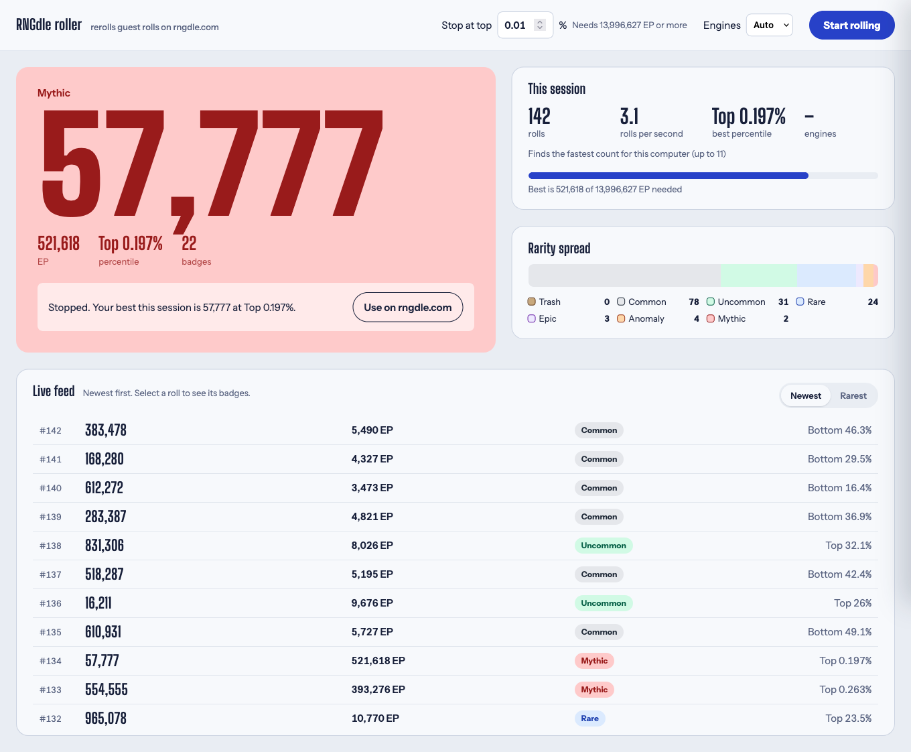
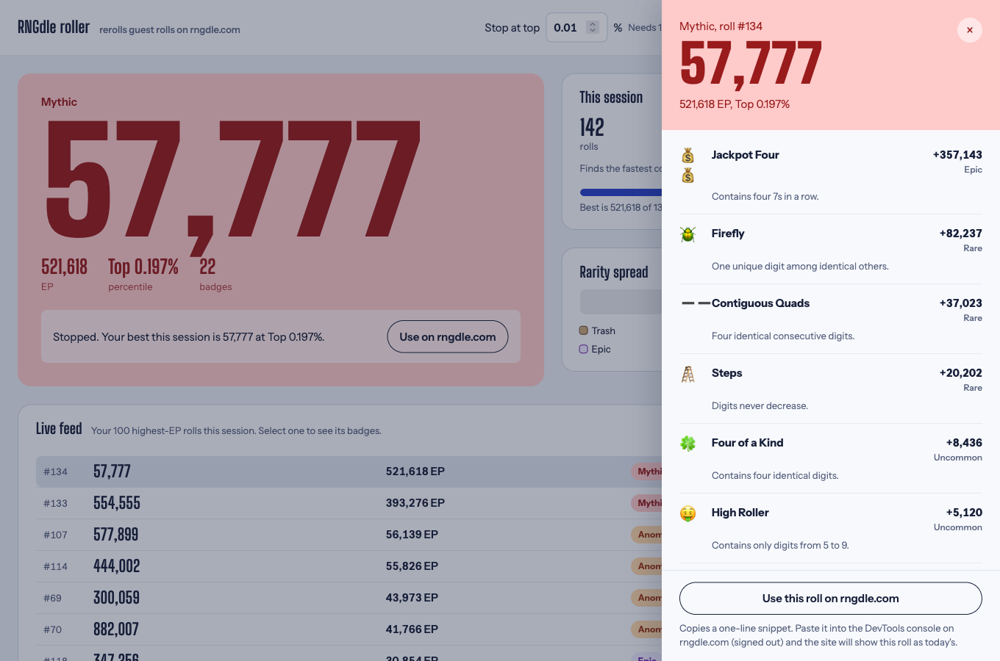

# rngdle-roller

A local tool that rerolls your **guest** roll on [rngdle.com](https://rngdle.com) until it reaches a rarity you choose. It comes with a live dashboard and a one-file console script.

> Unofficial and not affiliated with RNGdle. It only touches guest rolls, which live in your own browser. It can't change account rolls or the leaderboard: those are rolled on RNGdle's server.



## How it works

For players who aren't signed in, RNGdle rolls the number in the browser (`Math.random()`), scores it with the site's own badge rules, and saves it to `localStorage` as today's roll. Rerolling means clearing that saved roll and pressing **Generate** again. This tool does that for you, quickly, using the real site and its real button.

## Requirements

- [Node.js](https://nodejs.org) 18 or newer (no packages to install)
- A Chromium browser (Chrome, Edge, Brave, Arc) for full speed. Firefox works but much more slowly; Safari is untested. See [Limitations](#limitations).

## Dashboard

```bash
npm start
```

Then open **http://localhost:4321/__roller/**.

- **Stop at top X%:** the goal, shown with the EP it needs. It uses the site's own score-to-percentile table.
- **Engines:** how many copies of the site roll in parallel. **Auto** starts with one and adds more while the rate keeps going up, so it finds the fastest count for your CPU. You can also pick a fixed number.
- **Live feed:** every roll with its number, EP, rarity and percentile. Switch to **Rarest** to see your 100 best rolls of the session.
- **Details:** click a roll to see every badge, its EP, and which badges didn't count. A badge doesn't count when a bigger one in the same family already did.



Use a different port with `PORT=5000 npm start`.

### Putting a roll on rngdle.com

The dashboard runs the site through `localhost`, so its rolls are saved there, not on rngdle.com. To use one:

1. Click the roll, then **Use this roll on rngdle.com**. This copies a one-line snippet and opens the site.
2. On rngdle.com, **signed out**, open the DevTools console (`Cmd+Option+J` on Mac, `Ctrl+Shift+J` on Windows/Linux).
3. Paste and press Enter. Chrome may ask you to type `allow pasting` first. The page reloads showing that roll.

The site only accepts a roll dated today (UTC), so apply it before midnight UTC.

## Console script (no server)

Paste [`console/rngdle-roller.js`](console/rngdle-roller.js) into the DevTools console on rngdle.com while signed out. A small panel lets you change the goal. It rolls until it hits, then reloads to show the result. **Stop** keeps the best roll found so far. It's slower than the dashboard (one engine) but needs nothing installed.

## Under the hood

- `dashboard/server.js` serves the dashboard and proxies rngdle.com under `localhost`. It only proxies reads, and only from rngdle.com, and it listens on loopback only. The site's build files are cached in memory and the page HTML is refreshed at most once a minute, so rolling barely touches RNGdle's servers.
- Each engine is a hidden iframe on its own `eN…localhost` hostname. That gives each one its own saved roll and its own browser process, so engines run on separate CPU cores. A small script the server injects into those pages clicks **Generate** and posts the result to the dashboard.
- Engines swap to a fresh hostname every 40 rolls. Without that, memory the site leaks on each page load builds up and rolling gradually slows down.

## Limitations

- **Guest rolls only, in one browser.** Nothing here reaches your account or the leaderboard, and a roll you apply won't show on your other devices.
- **Keep the dashboard visible.** Browsers slow down tabs that aren't on screen, engines included. The dashboard shows a notice when this happens.
- **Fastest in Chromium browsers.** On a 12-core Mac, Chrome reached about 90–100 rolls per second with 8–11 engines. Firefox works, but extra engines don't help there: Auto stays at 1 and rolls run at a few per second. Safari is untested and may not resolve `*.localhost` hostnames. Only tested on macOS.
- **Breaks when the site changes.** It depends on RNGdle's **Generate** button label (`aria-label="Generate a new number"`), its `localStorage` key names and its built-in score table. If the site changes them, you'll see an error saying what's missing.

## License

[MIT](LICENSE)
